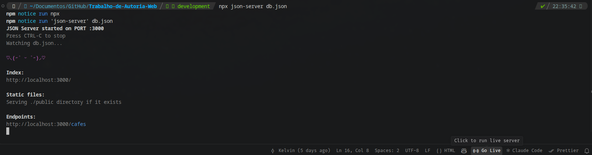

# Trabalho de Programação Visual e Autoria Web

Alunos: 
- Kelvin Nogueira da Silva - TADS 2026
- Everton Tallys - TADS 2026

## Como rodar o Projeto com o json-server (npm)
1. Copie os arquivos do projeto pelo comando gitclone: 

    <code> git clone https://github.com/KelvinNogueira-sudo/Trabalho-de-Autoria-Web.git </code>
2. Instale o json-server como dependência do projeto, pelo comando do terminal: 

    <code> npm install json-server </code>
3. Execute o servidor JSON pelo comando: 

    <code> npx json-server db.json </code>
4. Abra o arquivo index.html pelo VSCode e execute-o pela extensão Live Server
    
